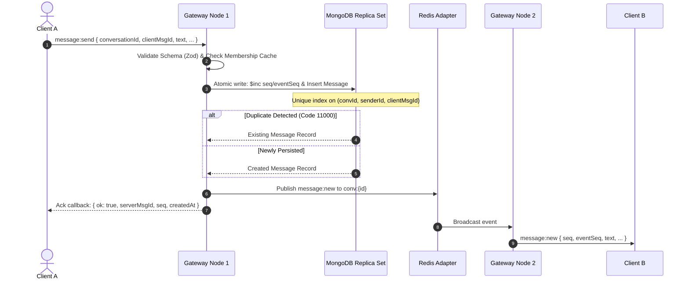

# Zena Real-Time Wire & Synchronization Protocol Specification

**Version**: `1.0.0`  
**Transport**: WebSocket only (`transports: ['websocket']`)  
**Base Path**: `/socket.io/`

---

## 1. Connection & Handshake Authentication

### 1.1 Handshake
The client establishes a WebSocket connection passing a short-lived JWT in the `auth` object:
```javascript
import { io } from 'socket.io-client';

const socket = io('https://chat.example.com', {
  transports: ['websocket'],
  auth: {
    token: '<short_lived_jwt_access_token>',
    deviceId: '<uuid_identifying_device_or_tab>',
    protocolVersion: '1.0.0'
  },
  reconnection: true,
  reconnectionAttempts: Infinity,
  reconnectionDelay: 1000,
  reconnectionDelayMax: 10000,
  randomizationFactor: 0.5 // Jitter to prevent reconnect storms
});
```

### 1.2 Heartbeat Tuning
- `pingInterval`: 25,000 ms (25s) — keeps Cloudflare and mobile carrier NAT state active.
- `pingTimeout`: 20,000 ms (20s) — fast detection of dropped 3G connections.

### 1.3 Re-Authentication & Token Expiry
Before the access token expires (15 minutes), the client obtains a fresh token via REST (`POST /api/v1/auth/refresh`) and emits:
```javascript
socket.emit('auth:refresh', { token: '<fresh_jwt>' }, (response) => {
  // response: { ok: true } or { ok: false, message: 'Invalid token' }
});
```
If an unauthenticated socket does not refresh in time or if the user is suspended, the gateway calls `socket.disconnect(true)`.

---

## 2. Room Management & Membership Isolation

- **Personal User Room**: `user:{userId}` — joined on connection. Used for targeted alerts and single-user notifications.
- **Conversation Rooms**: `conv:{conversationId}` — joined only after server-side membership validation.
- **Dynamic Membership Revocation**: When a user leaves or is kicked from a room, the server immediately evicts all of the user's sockets from `conv:{conversationId}` across all gateway nodes via Redis adapter.

---

## 3. Idempotent Message Send Flow



### Event Payload: `message:send`
```json
{
  "conversationId": "651f8a8b1234567890abcdef",
  "clientMsgId": "d3b07384-d113-49d6-95f0-621cf81c3d82",
  "text": "Hello Addis Ababa!",
  "attachmentId": null,
  "replyToId": null
}
```

### Ack Response:
```json
{
  "ok": true,
  "serverMsgId": "651f8a8b1234567890abcdef",
  "seq": 42,
  "createdAt": "2026-11-01T02:00:00.000Z"
}
```

---

## 4. Receipts as Forward-Only Cursors

Clients batch receipt confirmations to avoid spamming the connection:
- `receipt:delivered` `{ conversationId: "...", upToSeq: 42 }`
- `receipt:read` `{ conversationId: "...", upToSeq: 42 }`

The gateway advances the member's `lastDeliveredSeq` or `lastReadSeq` in MongoDB using `$max` and broadcasts `receipt:update` to the conversation room:
```json
{
  "conversationId": "651f8a8b1234567890abcdef",
  "userId": "651f8a8b9999999999abcdef",
  "deliveredSeq": 42,
  "readSeq": 35,
  "updatedAt": "2026-11-01T02:00:05.000Z"
}
```

---

## 5. Sync-by-Cursor Protocol (`sync:request`)

The formal correctness mechanism for reconnects and gap recovery.

### Request:
```json
{
  "cursors": {
    "651f8a8b1234567890abcdef": 40,
    "651f8a8b5555555555abcdef": 112
  }
}
```

### Response:
```json
{
  "ok": true,
  "events": [
    {
      "type": "message",
      "conversationId": "651f8a8b1234567890abcdef",
      "eventSeq": 41,
      "data": { "seq": 41, "text": "Are you online?", "senderId": "..." }
    },
    {
      "type": "edit",
      "conversationId": "651f8a8b1234567890abcdef",
      "eventSeq": 42,
      "data": { "messageId": "...", "text": "Are you online right now?" }
    }
  ],
  "hasMore": false
}
```

---

## 6. Presence Protocol

1. **Heartbeat refresh**: Sockets refresh Redis key `presence:{userId}:{deviceId}` with a 45s TTL.
2. **Snapshot**: On connect, the gateway emits `presence:snapshot` containing the live online state of all users sharing conversations with the client.
3. **Targeted updates**: When a user transitions online or offline, `presence:update` is sent exclusively to their mutual conversation contacts.

---

## 7. Ephemeral Typing Indicators

- `typing:start` `{ conversationId }` — throttled to at most once per 3s per user per room.
- `typing:stop` `{ conversationId }`
- Automatically discarded if room size exceeds 50 members.
- Client auto-clears typing indicators after 5s without fresh events.
